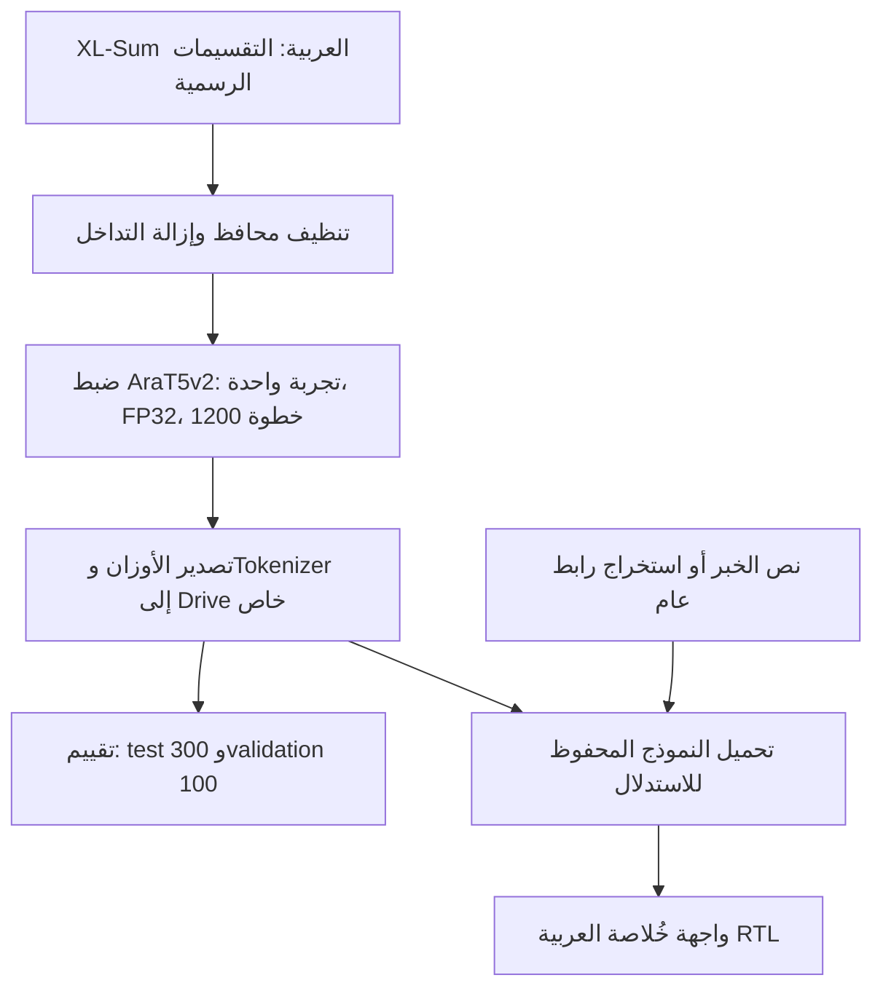

# خُلاصة | Khulasa

**الخبر كاملًا؟ خذ خُلاصته.**

خُلاصة تطبيق لتلخيص الأخبار العربية توليديًا، طوّرته **ندى علي** باستخدام `UBC-NLP/AraT5v2-base-1024` بعد ضبطه إشرافيًا على الجزء العربي من **XL-Sum**. يحوّل نص الخبر أو رابط المقال إلى ملخص عربي، مع اختيار الطول ونسخ النتيجة وعرض عدد الكلمات ونسبة الاختصار وزمن التوليد.

اكتمل تدريب النموذج النهائي لمدة **1200 خطوة**، وتضم الحزمة نتائج تقييمه الفعلية. الأوزان موجودة في **مجلد Google Drive خاص**؛ لا يتضمن GitHub الأوزان ولا يتيح تنزيلها تلقائيًا. يحتاج المدرّس أو أي متعاون إلى إذن مستقل للوصول إلى ملفات النموذج الكاملة قبل تشغيل التلخيص. لا توجد استضافة دائمة أو صور واجهة مرفقة في المستودع.

## الدفاتر النهائية

| الدفتر | الغرض | فتح مباشر |
|---|---|---|
| [Arabic_News_Gradio.ipynb](notebooks/Arabic_News_Gradio.ipynb) | عرض خُلاصة من الأوزان المحفوظة، دون تدريب | [Colab](https://colab.research.google.com/github/nada-ali-13/Arabic-news-summarizer/blob/main/notebooks/Arabic_News_Gradio.ipynb) |
| [Arabic_News_Evaluation.ipynb](notebooks/Arabic_News_Evaluation.ipynb) | تقييم 300 اختبار و100 تحقق ومقارنة نموذجي 200 و1200 خطوة | [Colab](https://colab.research.google.com/github/nada-ali-13/Arabic-news-summarizer/blob/main/notebooks/Arabic_News_Evaluation.ipynb) |
| [Arabic_News_Training_1200.ipynb](notebooks/Arabic_News_Training_1200.ipynb) | توثيق تجربة التدريب النهائية؛ لا حاجة لإعادتها لعرض المشروع | [Colab](https://colab.research.google.com/github/nada-ali-13/Arabic-news-summarizer/blob/main/notebooks/Arabic_News_Training_1200.ipynb) |

الروابط تشير إلى فرع التسليم لتعمل قبل دمج PR. مصادر خلايا الدفاتر من حزمة التسليم كما وردت، بمخرجات نظيفة؛ أزيلت فقط بيانات عرض widgets القديمة ومراجع مخرجات Colab من دفتر التدريب. تثبّت مصدر المساعدات عند `d1b24cbeef87aa61e45693fd5f7895a9f8db6f05` للحفاظ على إعدادات التجربة الفعلية؛ دفتر العرض يتضمن خلية الواجهة النهائية بنفسه. يستدعي آخر دفتر التدريب 1200 واجهة من ذلك المصدر المثبّت؛ للعرض النهائي استخدم **دفتر Gradio** أو `app.py` الحالي.

## البنية وطريقة العمل



AraT5v2 نموذج encoder–decoder من عائلة T5 بسياق 1024 token. التدريب **Full-parameter supervised fine-tuning** على أزواج المقال والملخص، وليس LoRA؛ جميع المعاملات قابلة للتدريب. تستخدم البيانات التقسيمات الرسمية لـ`csebuetnlp/xlsum` من أرشيف Arabic XL-Sum v2: عدد الصفوف قبل التنظيف 37,519 تدريبًا و4,689 تحققًا و4,689 اختبارًا.

تحافظ المعالجة على الحروف العربية والأرقام والتشكيل، وتطبّع Unicode وتزيل التطويل والمحارف غير المرئية وتوحّد المسافات. تُزال الصفوف الفارغة والتداخلات المطابقة في النص المطبّع أو المعرّفات أو الروابط بين التقسيمات، بأولوية الاختبار ثم التحقق ثم التدريب. لا يكشف ذلك التشابه الدلالي أو تلوث بيانات التدريب المسبق؛ قد تبقى تكرارات داخل الاختبار الرسمي.

## بروتوكول التدريب والتقييم

التجربة النهائية مستقلة عن نموذج 200 خطوة، وبدأت من الأوزان الأصلية المدرّبة مسبقًا. الإعدادات: FP32، معدل تعلّم `5e-5`، batch size يساوي 1، تجميع gradients كل 8 دفعات، AdamW وجدولة linear مع warmup بنسبة 6%، weight decay يساوي 0.01، وقص gradients عند 1.0. حد المصدر 1024 وحد الهدف 128 token، والبذرة 42. استُخدم gradient checkpointing لتقليل الذاكرة؛ وهو مختلف عن حفظ checkpoints على القرص.

الحد 1200 optimizer step مع ميزانية تدريب 85 دقيقة وإيقاف طبيعي عند نهاية الخطوة. لا توجد checkpoints دورية أو استعادة optimizer/scheduler/RNG. يبقى العمل في `/content`، ثم تُصدّر الأوزان النهائية وTokenizer بصيغة safetensors إلى مجلد Drive جديد. فقدان الجلسة قبل التصدير يفقد التقدم. هذا توثيق للتجربة المكتملة وليس طلبًا لإعادتها.

دفتر التدريب يحتوي تقييمًا أوليًا على 64 مثال اختبار و96 تحققًا. **النتائج النهائية أدناه من دفتر التقييم المنفصل**: 300 مقال test و100 validation، ببذرة 42، مع مقارنة النموذجين على الأمثلة نفسها. مجموعة الـ300 تتضمن مجموعة الـ64 التي استُخدمت سابقًا للمقارنة؛ لذلك فهذا تقييم موسّع وصفي، وليس اختبارًا جديدًا مستقلًا تمامًا عن قرارات التطوير.

التوليد في التقييم: FP32، أربع حزم بحث (`num_beams=4`)، دون sampling، حتى 128 token جديدًا وبحد أدنى 8، ومنع تكرار ثلاثيات tokens و`repetition_penalty=1.1`. تُقتطع المدخلات إلى 1024 token. تُحسب ROUGE بمتوسط F1 لكل مثال ×100، باستخدام tokenizer يحافظ على الكلمات العربية دون stemming، وحدود جمل عربية/لاتينية لـROUGE-Lsum. المقارنة مع أوراق علمية تتطلب تطابق المعالجة والبروتوكول.

## النتائج الفعلية

المصدر: [metrics_summary.json](reports/metrics_summary.json)، محفوظ **دون تغيير** من حزمة التسليم. الأرقام هنا مقربة لأربع منازل؛ لم يُعد Codex حسابها بتشغيل النموذج.

| المجموعة | النموذج | ROUGE-1 | ROUGE-2 | ROUGE-L | ROUGE-Lsum |
|---|---|---:|---:|---:|---:|
| test — 300 مقال | 200 خطوة | 25.3503 | 11.0909 | 21.4979 | 21.5155 |
| test — 300 مقال | **1200 خطوة** | **29.3202** | **13.8862** | **25.2062** | **25.2373** |
| validation — 100 مقال، منفصلة | 200 خطوة | 27.1722 | 11.8153 | 24.1840 | 24.1840 |
| validation — 100 مقال، منفصلة | 1200 خطوة | 28.4868 | 12.9437 | 25.6754 | 25.7954 |

تحسن ROUGE-Lsum على الاختبار بمقدار **3.7218 نقطة**، أي **17.2983% نسبيًا** مقابل نموذج 200 خطوة على الأمثلة نفسها. فاصل الثقة paired bootstrap بنسبة 95% لفرق الاختبار `[2.308, 5.049]` نقطة؛ أما فرق validation ففاصله `[-0.939, 4.156]` ويشمل الصفر.

**ROUGE ليس Accuracy ولا درجة لصحة الوقائع.** حقول التدقيق البشري لم تُملأ، ولم تكتمل مراجعة الحقائق. قد يختلق النموذج أسماء أو أعدادًا أو أحداثًا، أو يحذف حقائق أساسية؛ يجب مراجعة المصدر.

## تشغيل العرض على Colab

1. افتح دفتر **Arabic_News_Gradio** واختر جلسة جديدة؛ يُفضّل T4 GPU.
2. احصل على وصول مسموح إلى الأوزان الكاملة وTokenizer. عدّل `MODEL_DIR` في خلية الإعدادات إلى مجلد `/model` المتاح لحسابك؛ المسار المرفق خاص ببيئة المؤلفة ولا يمنح صلاحية وصول.
3. شغّل خلايا التثبيت، وربط Drive، وجلب المساعدات، وتحميل النموذج واختباره، ثم خلية Gradio بالترتيب. لا تشغّل دفتر التدريب لعرض التطبيق.
4. أدخل نصًا أو رابطًا واحدًا واختر قصيرًا أو متوسطًا أو طويلًا. استخدم زر النسخ لنسخ الملخص، وزر المسح لإفراغ الحقول.

`share=True` ينشئ رابط `gradio.live` عامًا **مؤقتًا** يحتاج إلى استمرار جلسة Colab؛ لا يمثل استضافة دائمة. أوقف خلية الواجهة أو الجلسة لإنهائه. **لم يختبر Codex هذه النسخة مباشرة على Colab الخاص بالمستخدمة.**

## التشغيل المحلي

المطلوب Python 3.10–3.13، وPyTorch 2.6 أو أحدث ضمن الإصدار 2، ومجلد نموذج كامل ممنوح لك. يضم المجلد `config.json`، ملفات safetensors، وملفات Tokenizer بما فيها `tokenizer_config.json` وملف المفردات المناسب. لا تستخدم مجلد تجربة قديمًا أو ملف JSON بدل مجلد النموذج.

```bash
git clone https://github.com/nada-ali-13/Arabic-news-summarizer.git
cd Arabic-news-summarizer
git switch codex/khulasa-final-submission
python -m venv .venv
source .venv/bin/activate
python -m pip install torch==2.8.0 --index-url https://download.pytorch.org/whl/cpu
python -m pip install -e .
export USE_TF=0 USE_FLAX=0
export ARABIC_SUMMARIZER_MODEL=/absolute/path/to/permitted/model
python app.py
```

افتح العنوان المحلي الذي يطبعه Gradio. لمشاركة عامة مؤقتة اختياريًا: `python app.py --share`. في Colab احتفظ بنسخة PyTorch/CUDA الموجودة بدل تثبيت نسخة CPU. البديل الافتراضي محليًا هو `artifacts/best/`، لكنه غير مرفق. يستورد التطبيق ويبني الواجهة دون تحميل الأوزان ثم يحمّلها عند أول طلب؛ لا يعتمد على متغير `summarizer` عام في notebook.

يمكن استخدام الواجهة الحالية من دفتر مع نموذج محمّل بالفعل:

```python
from app import build_app
demo = build_app(summarizer=summarizer)
demo.launch(share=True, inline=True)
```

الاستدلال المحلي يستخدم FP32 على CPU أو CUDA مثل دفتر العرض النهائي. الأوزان وحدها تقارب 1.47 GB؛ يلزم هامش إضافي لـPython والبحث بالحزم والمدخلات. تقدير RAM أولي 4–6 GB ليس حدًا مقاسًا للاستضافة. لم تُقَس سرعة النموذج الكامل محليًا.

## قدرات الواجهة وحدودها

- إدخال نص أو استخراج مقال من رابط HTTP/HTTPS عام. قد تفشل الصفحات المحمية أو الديناميكية؛ الصق النص عند الفشل. يحتفظ المستخرج بفحوص العناوين العامة والتحويلات وحدود الاستجابة والمهلة.
- أطوال قصير/متوسط/طويل بحدود توليد 64/96/128 token، وليست عدد كلمات مضمونًا. قد تكون نسبة الاختصار سالبة إذا طال الناتج.
- النصوص الطويلة في التطبيق تُلخّص على مقاطع ثم تدمج؛ قد تضيع العلاقات بينها وتتراكم الأخطاء. يختلف ذلك عن اقتطاع المصدر في التقييم. تُرفض المدخلات فوق 100 ألف حرف أو 16 مقطعًا.
- واجهة عربية RTL تتكيف مع الشاشات الصغيرة، مع أخطاء الإدخال وتحذيرات النتيجة. طلب توليد واحد في الوقت نفسه وطابور محدود.
- لا يوجد تحقق آلي من صحة الأخبار، ولا ضمان لتغطية كل التفاصيل أو التعميم خارج الأخبار العربية.

## تنظيم المستودع والتحقق

| المسار | الدور |
|---|---|
| `app.py` | واجهة خُلاصة النهائية مع `build_app(summarizer=None)` |
| `notebooks/Arabic_News_{Training_1200,Evaluation,Gradio}.ipynb` | الدفاتر النهائية المرفقة |
| `src/arabic_summarizer/` | مساعدات النص والبيانات والمقاييس والاستدلال والروابط والسلامة العددية؛ ووحدات تدريب تاريخية محفوظة |
| `reports/metrics_summary.json` | النتائج الفعلية كما وردت |
| [reports/FINAL_SUBMISSION.md](reports/FINAL_SUBMISSION.md) | تدقيق الملفات ومصدر الحزمة والتحقق وحدوده |
| `tests/` | اختبارات المساعدات والأمان والواجهة والدفاتر؛ واختبارات قديمة محفوظة |

دفتر `Arabic_News_Summarizer_Training.ipynb` و`configs/dev.json` و`configs/full.json` ووحدتا `training.py` و`checkpoints.py` وتقارير التشغيل القديمة **تاريخية**، وليست المسار الموصى به للتسليم. احتُفظ بها في أماكنها لوجود اعتمادات واختبارات؛ لم يُدمج PR #3 أو PR #4، ولم تُضف منظومة الاستعادة القديمة إلى الدفاتر النهائية.

```bash
python -m pip install -r requirements-dev.txt
ruff check .
USE_TF=0 USE_FLAX=0 HF_HUB_OFFLINE=1 GRADIO_ANALYTICS_ENABLED=False pytest -q
python -m compileall -q src app.py scripts
```

تتحقق اختبارات الدفاتر من البنية وصياغة كل خلية دون تنفيذ التدريب أو تحميل النموذج. اختبارات التدريب القديمة تستخدم T5 صغيرًا عشوائيًا محليًا؛ لا تمثل تدريب نموذج المشروع أو نتائج جودته. راجع [تقرير التسليم](reports/FINAL_SUBMISSION.md) لمعرفة الفحوص المنفذة فعليًا.

## النسب والمراجع

**تصميم وتطوير: ندى علي.**

المشروع مبني على [AraT5](https://aclanthology.org/2022.acl-long.47/) و[AraT5v2 / Octopus](https://aclanthology.org/2023.arabicnlp-1.20/) و[XL-Sum](https://aclanthology.org/2021.findings-acl.413/) ومصادر BBC ضمن البيانات. ترخيص XL-Sum هو CC BY-NC-SA 4.0؛ ترخيص البيانات منفصل عن حقوق أوزان النموذج. راجع [سجل التوافق والمراجع](reports/COMPATIBILITY.md). لا يفترض المستودع الإذن بإعادة نشر الأوزان؛ أي استضافة مستقبلية تحتاج وصولًا مسموحًا وموارد مقاسة ومراجعة حقوق الاستخدام.
