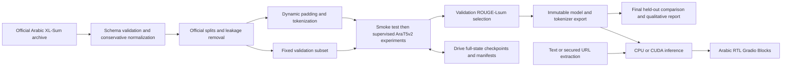

# Arabic News Summarizer | ملخّص الأخبار العربية

Arabic abstractive news summarization with `UBC-NLP/AraT5v2-base-1024` and the Arabic split of `csebuetnlp/xlsum`. The recommended training entry point is now **one FP32 Colab T4 experiment**, followed by a final inference-only export and the existing Arabic Gradio app.

[Open the single-run FP32 notebook in Colab](https://colab.research.google.com/github/nada-ali-13/Arabic-news-summarizer/blob/codex/simple-colab-fp32/notebooks/Arabic_News_Single_Run_FP32.ipynb)

## Run the single experiment in Colab

1. Start a fresh runtime (**Disconnect and delete runtime**, then select **T4 GPU**). Run the new notebook from top to bottom; it installs pinned dependencies while preserving Colab's CUDA PyTorch.
2. Cell 1 contains the settings: `MAX_STEPS=200`, learning rate fixed at `5e-5`, batch 1, accumulation 8, source/target limits 1024/128, FP32, and a 90-minute training budget. This is one full-parameter experiment. Its first three optimizer steps print an approximate duration estimate; the budget stops normally at a step boundary and proceeds to export. More steps do not guarantee quality.
3. Cells 2–6 verify GPU/precision, load the official Arabic-only archive, preserve and clean official splits, prepare teacher-forced labels with `-100` padding, and mount Drive. Enter available storage from the Drive storage page when prompted. The check covers the final FP32 export (roughly 1.5 GB weights plus a margin), using the actual parameter size. No quota API or Drive deletion is used.
4. **Cell 7 trains and immediately saves the final model/tokenizer to a new folder**: `MyDrive/ArabicNewsSummarizer/single-fp32-<timestamp>-<id>/model/`. Wait for `FINAL EXPORT COMPLETE`. No generation evaluation occurs before export. If upload fails while the runtime survives, rerunning this cell skips the completed training and retries export.
5. Cells 8–10 independently reload the saved folder, compute Arabic-aware ROUGE-1/2/L/Lsum on a seeded 64-row held-out test subset, show three articles/references/predictions, and test editable custom Arabic text. Evaluation JSON stays local under `/content`; download it if needed.
6. Cell 11 optionally launches the existing Arabic Gradio app. Set `LAUNCH_GRADIO=True` to create its temporary public link. Later, copy the complete export folder and set `ARABIC_SUMMARIZER_MODEL` to that folder before running `python app.py` (see the notebook for Colab and local instructions).

**Storage policy:** `save_strategy="no"`, no periodic full-state checkpoints and no resume. All training output, Hugging Face caches and intermediate data stay on `/content`. Drive receives only final safetensors weights, tokenizer, model/generation configs and small inference metadata; no optimizer, scheduler, RNG or Trainer state. The old `full-v2-fp32-final-01` directory and all other old runs/Trash are untouched. A disconnect before export finishes loses the run; start again in a fresh runtime. Leave time for the final upload before Colab ends.

**Validation:** The new notebook passed notebook schema validation, compilation of every code cell, and lightweight offline checks of timing/budget behavior, export ordering, and the reused Arabic normalization/split logic. No full model training or gigabyte downloads were run in Codex. Dependency installation in Colab, real T4 memory/timing/training, Drive export and reload, real ROUGE quality, and live Gradio remain unverified until the notebook runs there. The earlier [T4 FP32 smoke evidence](reports/T4_SMOKE_RESULT.json) concerns the previous pipeline, not execution of this new notebook.

## Legacy workflow reference

The remaining training/recovery sections below, the older `Arabic_News_Summarizer_Training.ipynb`, and the old configuration/report files document the previous workflow. They are retained for reference. **Use the new single-run notebook above for this task**; it does not call the old training/checkpoint pipeline, run its smoke/baseline/comparison experiments, or reuse its Drive runs. Shared Arabic preprocessing, ROUGE, numerical guards, inference and Gradio helpers are loaded from the fixed `main` base commit `d1b24cbeef87aa61e45693fd5f7895a9f8db6f05`.

## Architecture



## Model, dataset and preprocessing

The selected model is an encoder-decoder T5 with a 1,024-token supported context. Its public weights are approximately 1.47 GB in a PyTorch state dictionary. Initial loading uses PyTorch ≥2.6 with `weights_only=True`; local checkpoints/exports use `safetensors`. The large upstream model is deliberately not downloaded during CPU CI.

The published Arabic XL-Sum splits contain **37,519 train / 4,689 validation / 4,689 test** rows before cleaning. `data.py` downloads the official 44.9 MB `arabic_XLSum_v2.0.tar.bz2` from the same dataset repository. This avoids the obsolete executable `xlsum.py` loader, which modern `datasets` versions no longer support. It does not substitute another dataset. Archive paths are never extracted to the filesystem.

Normalization applies NFC, removes tatweel and invisible format/control characters, and collapses whitespace. Hamza forms, alef variants, ya/alif maqsura, ta marbuta, diacritics and numbers are retained. No aggressive stemming or letter folding is applied. Empty text/summary rows are removed and schema failures stop execution.

Official split membership is retained. Exact normalized-source hashes, IDs and nonempty URLs prevent overlap: held-out test rows have priority over validation, which has priority over training. Usable test rows are retained, including internal test duplicates; duplicates in lower-priority splits are excluded. This detects exact matches, not semantic near-duplicates or possible pretraining contamination. Statistics, removal counts and representative examples are saved in `dataset_statistics.json`.

## Bounded training plan

| Mode | Smoke | Genuine candidate training | Evaluation subset |
|---|---|---|---|
| dev | 2 optimizer steps, 8 rows | 10 steps, 64 rows, accumulation 2 | validation 8; final test 16 |
| full | 2 optimizer steps, 8 rows | two independent 1,200-step runs, LR 5e-5 and 1e-4, up to all train rows | validation 256; final test 512 |

The two learning rates provide a small comparison between conservative and faster adaptation. Each candidate starts from the same pinned pretrained model, seed, training order and fixed validation subset. The smoke run is excluded from best-model selection and its checkpoints are deleted only after success; its audit record remains.

Development and full modes explicitly default to FP32; selected precision is applied and verified against Accelerator, so a prior AMP environment cannot silently override it. Full training uses source length 1,024, target length 128, batch size 1, accumulation 16, AdamW, linear scheduling, 6% warmup, weight decay 0.01, clipping at 1.0, gradient checkpointing and dynamic padding. FP32 is the default; FP16 remains configurable and must pass its own smoke test. Early stopping has patience 3 validation evaluations. Saves/evaluations occur every 100 optimizer steps. Generation uses deterministic four-beam search and a three-token repetition block. Seeds are fixed, but exact cross-hardware determinism is not guaranteed.

The default session budget is 3 hours and cumulative compute budget 7 hours. Evaluation/checkpoint I/O can exceed a time boundary; checks occur between optimizer steps/stages. This is a stopping criterion, not a promise both experiments fit a free Colab session. Rerunning after a session pause continues the plan. If the total budget is exhausted, explicitly raise `max_hours`; raise storage limits only when space is available. Budget fields can change on restart; changed training semantics require a new run directory. T4 does not support BF16. Nonfinite loss, gradients or metrics stop execution with exact diagnostics. A new directory alone does not reset AMP state; follow the linked restart procedure rather than assuming a logged configuration proves FP32 was active.

## Recovery and artifact integrity

The numerical correction uses training schema 2, which deliberately rejects old schema-1 run configs/checkpoints. Preserve old runs and start a new v2 directory. Within v2, the existing full-state resume behavior is retained. `run(..., smoke_only=True)` verifies only smoke; setting it to `False` later continues the same plan without retraining completed smoke.

Checkpoints are saved **directly to Drive** under `experiments/<name>/checkpoint-<global_step>/`. This trades some I/O speed for persistence and avoids losing an entire session's checkpoints in `/content`.

Each includes model weights, optimizer, scheduler, Trainer state, global step/epoch, RNG state, training arguments and project configuration, plus AMP scaler state where the Trainer provides it. After the Trainer finishes saving, a SHA-256 manifest and `complete.json` commit marker are written. Recovery validates every listed file and ignores partial/corrupt checkpoints. It tries older saves before failing clearly when no complete checkpoint survives. `resume_from_checkpoint` restores the actual training state. Hashes detect accidental corruption; they do not authenticate files from unknown sources. Resume only your own trusted artifacts.

The Trainer retains at most two checkpoints per experiment (including its best). Completed real experiments export model/tokenizer into unique immutable `exports/<experiment>-<id>/` directories. An atomic `best.json` points to the highest validation ROUGE-Lsum; a worse later experiment cannot replace it. Checkpoints, exports and tokens are excluded from Git.

Unsaved steps since the last completed checkpoint may be lost. Drive disconnection/deletion cannot be undone by this code. A terminated runtime must be reopened by the user. Do not run concurrent notebooks against the same directory. For a new experiment plan, use a new run directory; do not delete the previous best export.

## Evaluation

The pretrained model is evaluated on the fixed validation subset before genuine fine-tuning. All candidates use the same IDs and generation settings. Model selection uses validation ROUGE-Lsum only. After the complete plan finishes, pretrained and selected fine-tuned models are evaluated on an identical seeded test subset. Set `test_samples` to 4,689 in a **new run configuration** if a full test evaluation is required; the default is explicitly a fixed subset.

Metrics are mean per-example F1 ×100: ROUGE-1, ROUGE-2, ROUGE-L and ROUGE-Lsum. `rouge-score` is given a Unicode word tokenizer: its default English-only tokenizer would discard Arabic. Stemming is disabled. Arabic/Latin sentence punctuation determines newline boundaries for ROUGE-Lsum. Conservative normalization matches training. These scores are not directly interchangeable with papers using different Arabic segmentation or normalization. Generation length is bounded. Training labels are truncated to the target token limit for loss computation, while ROUGE uses the full normalized reference summaries. Saved examples retain those same full references for independent recomputation.

```bash
python scripts/evaluate.py /path/to/run/best_test.json
```

Raw predictions, full references, sources and IDs are saved for qualitative review. Use [the review rubric](reports/QUALITATIVE_REVIEW.md) to check factuality, coverage, repetitions, fluency, length and completeness. ROUGE measures overlap, not truthfulness. No evaluation scores are fabricated or prefilled.

## Local application

Use Python 3.10–3.13 (validated on 3.12). Create a virtual environment. On CPU-only machines install CPU PyTorch first to avoid unnecessary CUDA downloads:

```bash
python -m venv .venv
source .venv/bin/activate
pip install torch==2.8.0 --index-url https://download.pytorch.org/whl/cpu
pip install -e .
export ARABIC_SUMMARIZER_MODEL=/absolute/path/to/selected/export
python app.py
```

Alternatively copy the complete selected export to `artifacts/best/`. Do not point inference at the experiment root or `best.json`; use the directory named by its `path`. Model weights are loaded lazily on the first request. CPU uses float32; CUDA uses float16. To inspect the untrained baseline explicitly, set the model variable to `UBC-NLP/AraT5v2-base-1024`; this does not make it a fine-tuned summarizer. The app defaults to requiring a trained local export.

The Arabic RTL interface accepts text **or** a URL, provides short/medium/long preferences (64/96/128 generation-token ceilings), a copy button, word counts, reduction percentage and generation time. Length is a preference, not a guaranteed word count; reduction can be negative if output is longer. Examples are original project-written passages. One inference runs at a time and the queue is bounded.

Long inputs use token windows with no silent truncation: summarize each window, then recursively summarize the merged outputs. Inputs over 16 windows or 100,000 characters are rejected. This can lose cross-section relationships and compounds summarization errors. Training/evaluation use truncation to the configured source limit; the UI's hierarchical path is a separately documented inference strategy.

### Article URLs

Use public HTTP/HTTPS article URLs on standard ports. The fetcher rejects userinfo, nonweb schemes, nonpublic/private/local/metadata addresses and mixed public/private DNS answers. Every redirect is resolved and checked again. Connections use a validated numeric IP, preserving the original Host header and HTTPS certificate/SNI hostname, preventing DNS rebinding between validation and connection. Automatic redirects, retries, environment proxies and cookies are disabled. Responses are bounded to 2 MB, with connection/read timeouts and a streaming wall-time check; compressed replies are rejected to avoid decompression bombs.

Trafilatura extracts the main body. No browser, JavaScript execution or subresource downloads occur. Paywalls, bot protection, unavailable DNS, proxy-only networks and JavaScript-only pages can fail. Paste text manually when the Arabic error asks you to do so. Live public fetching was not verified in the restricted build environment; controlled Arabic HTML/redirect/security fixtures were exercised.

### CPU memory and latency

The upstream float32 weights alone are about 1.47 GB; Python, tokenization, beam search and activations add memory. Budget **at least 4–6 GB RAM as an initial estimate**, then measure on the target machine. This is not a verified hosting minimum and a small free CPU Space may be insufficient. Long inputs can be slow.

```bash
python scripts/benchmark.py --model /path/to/export --text-file article.txt --device cpu --runs 3
```

The benchmark records actual cold load, generation times and Linux peak RSS. No full-model CPU timing has been measured here, because the 1.47 GB weights were intentionally not downloaded. Tiny-test latency is not representative.

## Hugging Face Spaces preparation

Development, Colab training and local testing need no Hugging Face account. Publishing to Spaces later requires an account, available hardware, authorization and resolving the model-weight redistribution license. Nothing has been deployed.

Copy `deployment/README.md` to the root of a new Gradio Space, with `app.py`, `src/`, `pyproject.toml` and `requirements.txt`. Add the exported model/tokenizer under `artifacts/best/` using the host's supported large-file workflow, or configure an accessible model repository and `ARABIC_SUMMARIZER_MODEL`. Set `PYTHONPATH=src` in the Space environment when using this source layout. Do not commit checkpoints to this source Git repository. Choose hardware based on measured memory/latency, rather than assuming free CPU capacity is sufficient.

## Repository map and checks

- `notebooks/Arabic_News_Summarizer_Training.ipynb`: primary executable notebook.
- `src/arabic_summarizer/`: config, data, text, ROUGE, checkpoints, training, inference and secure articles.
- `configs/`: development/full bounded plans.
- `app.py`: Arabic Gradio Blocks UI, with no model downloads on import/build.
- `scripts/`: saved-output evaluation and measured inference benchmark.
- `tests/`: unit, security, application and actual tiny-model CPU training/recovery tests.
- `reports/`: provenance, validation and qualitative-review documentation.
- `.github/workflows/tests.yml`: repeatable CPU checks; [remote CPU validation passed](https://github.com/nada-ali-13/Arabic-news-summarizer/actions/runs/42208195534) for the implementation commit.

```bash
pip install -r requirements-dev.txt
ruff check .
pytest -q
python -m compileall -q src app.py scripts
```

## Presenting to an instructor

Explain transfer learning from an Arabic denoising T5 to article→summary supervision. Show the official split policy, one recorded optimizer checkpoint, and the recovery log's resumed global step. Display the real baseline/fine-tuned test comparison, then inspect an accurate example and a failure case. Demonstrate text input, an accessible URL, length preferences and copying. Keep a saved local example in case external sites fail. Report compute/time budgets, the fixed evaluation subset, any pauses, license uncertainty and limitations honestly. Do not present a development run as final-quality training.

Future work includes semantic deduplication, human factuality evaluation, morphology-aware comparison metrics, more capable long-document handling and measured deployment optimization. These are not claimed implemented features.
