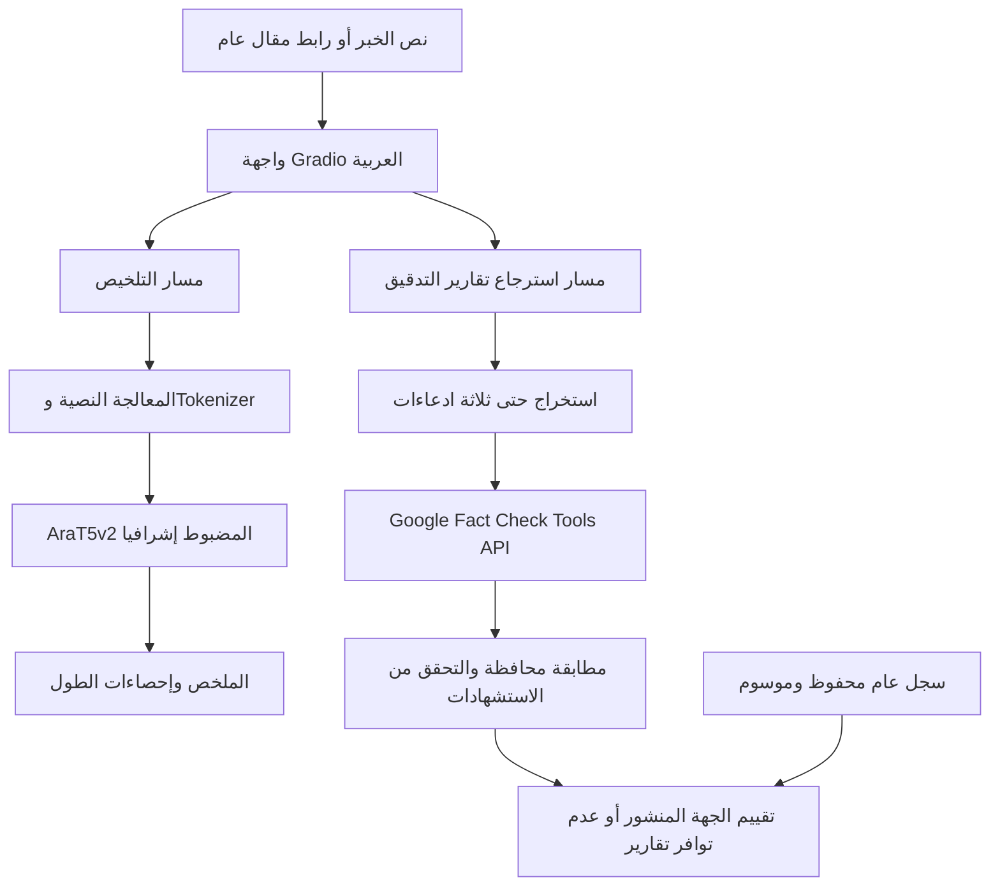
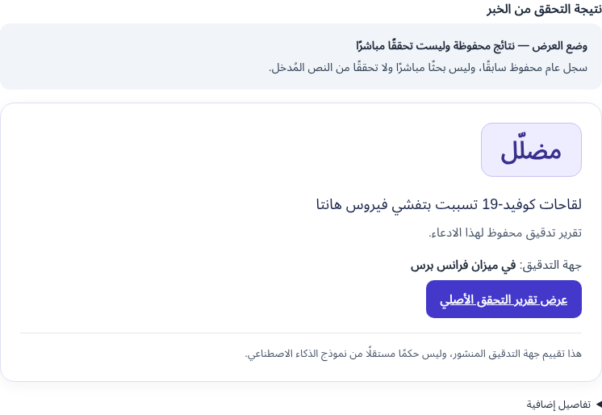
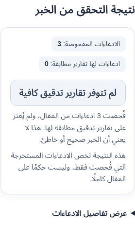

# خُلاصة | Khulasa

**تلخيص الأخبار العربية واسترجاع تقارير التدقيق المنشورة**
**تصميم وتطوير: ندى علي**

## الملخص

خُلاصة نظام لمعالجة الأخبار العربية يجمع التلخيص التوليدي واسترجاع تقارير التحقق المنشورة في واجهة Gradio عربية تدعم اتجاه الكتابة من اليمين إلى اليسار. تعتمد وحدة التلخيص على `UBC-NLP/AraT5v2-base-1024` بعد ضبطه إشرافيًا على Arabic XL-Sum. وتستخرج وحدة التدقيق حتى ثلاثة ادعاءات بقواعد لغوية محافظة، ثم تسترجع تقارير مطابقة عبر Google Fact Check Tools API، مع الحفاظ على تقييم الجهة الناشرة والاستشهاد بالمصدر. لا يُستخدم نموذج التلخيص لتصنيف حقيقة الأخبار، ولا ينتج النظام حكمًا كليًا على صحة المقال.

يضم المستودع الشيفرة المصدرية للنظام، ودفاتر التدريب والتقييم والتشغيل، ونتائج التجارب، والتوثيق الفني. يُوصى باستخدام [دفتر Colab النهائي](notebooks/Khulasa_Final_Demo.ipynb) لتشغيل واجهة التطبيق، مع مراعاة متطلبات الوصول إلى الأوزان المدرّبة وإعداد خدمة تدقيق الأخبار.

## 1. المشكلة والأهداف

تحد كثافة الأخبار العربية وطول مقالاتها من سرعة الاطلاع، كما قد تتضمن الأخبار ادعاءات تستلزم الرجوع إلى تقارير تدقيق متخصصة. يهدف المشروع إلى اختزال المقالات مع الحفاظ على المعلومات الأساسية، وإتاحة البحث عن تدقيق منشور مستقل عن عملية التلخيص. تشمل الأهداف توثيق منهجية الضبط والتقييم، وإظهار مصادر نتائج التدقيق وحدودها، وتوفير تشغيل قابل للمراجعة دون دمج نتائج التلخيص مع أحكام صحة الأخبار.

## 2. الوظائف الأساسية

| الوظيفة | المدخلات والمعالجة | المخرجات |
|---|---|---|
| تلخيص المقال | نص عربي أو رابط عام قابل للاستخراج؛ اختيار قصير أو متوسط أو طويل | ملخص قابل للنسخ، وعدد الكلمات ونسبة الاختصار وزمن التوليد |
| التحقق من الخبر | استخراج حتى ثلاثة ادعاءات والبحث عن تقارير منشورة ذات صلة محافظة | تقييم الناشر الأصلي واسمه ورابط التقرير؛ أو حالة عدم توافر تقارير كافية |
| عرض محفوظ | سجل AFP عام موثق بتاريخ استرجاع 2026-11-09 | مثال محفوظ موسوم بوضوح؛ لا يمثل بحثًا مباشرًا أو تحققًا من إدخال جديد |

الوظيفتان مستقلتان؛ تعذر خدمة التدقيق لا يمنع التلخيص. GDELT وNLI مكوّنان اختياريان غير مفعّلين في الإعداد الافتراضي.

## 3. بنية النظام ومسار المعالجة



تُعزل وحدة الاستدلال عن واجهة العرض ووحدات التدقيق. تستخدم روابط المقالات مستخرجًا محدود الحجم والمهلة، مع فحص DNS وعناوين الشبكة وإعادة التحقق من التحويلات للحد من SSRF. يظل المحتوى المسترجع بيانات غير موثوقة؛ لا تُنفذ تعليماته وتُهَرَّب حقوله عند العرض.

## 4. البيانات والمعالجة المسبقة

استُخدم الجزء العربي من [XL-Sum](https://huggingface.co/datasets/csebuetnlp/xlsum)، الذي يتكون من مقالات BBC وملخصاتها المرجعية. تُقرأ نسخة Arabic XL-Sum v2 من الأرشيف الرسمي مع التقسيمات التالية قبل التنظيف:

| التقسيم | عدد الأمثلة |
|---|---:|
| التدريب | 37,519 |
| التحقق validation | 4,689 |
| الاختبار test | 4,689 |

تشمل المعالجة تطبيع Unicode، وإزالة التطويل والمحارف غير المرئية وتوحيد المسافات، مع الاحتفاظ بالحروف والأرقام والتشكيل. تُزال الأزواج الفارغة والتداخلات المطابقة في النص المطبّع أو المعرّفات أو الروابط، بأولوية test ثم validation ثم train. لا تكشف هذه المعالجة التشابه الدلالي أو تلوث البيانات المسبق، ولا تضمن إزالة كل تكرار داخل التقسيم نفسه. تُوثق الشيفرة في [text.py](src/arabic_summarizer/text.py) و[data.py](src/arabic_summarizer/data.py).

## 5. بنية AraT5v2 والتوليد

AraT5v2 نموذج **Encoder–Decoder** من عائلة T5، مخصص لمعالجة النصوص وتوليدها. في هذا المشروع، يبلغ حد المصدر 1024 token.

- **Tokenization:** تقسيم النص إلى وحدات دون الكلمة باستخدام T5Tokenizer وSentencePiece؛ عدد tokens لا يساوي عدد الكلمات.
- **Embeddings:** تحويل معرّفات الوحدات إلى متجهات يتعلم النموذج تمثيلاتها أثناء التدريب؛ ليست هذه المتجهات درجات لصحة الوقائع.
- **Encoder وSelf-Attention:** بناء تمثيلات سياقية للمقال، مع إتاحة الانتباه بين وحدات المصدر. تستخدم بنية T5 معلومات موضعية نسبية.
- **Decoder:** يولّد الملخص تدريجيًا، باستخدام causal self-attention على الوحدات السابقة وcross-attention إلى مخرجات Encoder.
- **Text generation:** اختيار تسلسل الملخص باستخدام beam search في بروتوكول التقييم. لا يقتصر التلخيص التجريدي على نسخ الجمل، وقد ينتج معلومات غير دقيقة.

يعالج التطبيق النصوص الطويلة على مقاطع ثم يدمج ملخصاتها ضمن حدود عدد المقاطع؛ يختلف ذلك عن اقتطاع المصدر إلى 1024 token في التقييم. حدود أطوال الواجهة 64/96/128 token للخيارات الثلاثة، وليست أعداد كلمات مضمونة. يرفض التطبيق المدخلات فوق 100,000 حرف أو 16 مقطعًا.

## 6. منهجية الضبط وإعدادات التدريب

التجربة النهائية **Full-parameter supervised fine-tuning** على أزواج المقال والملخص، وليست LoRA. بدأت من الأوزان الأساسية بصورة مستقلة عن نموذج 200 خطوة؛ لم تكن استئنافًا لحالة تحسين محفوظة لذلك النموذج.

| الإعداد | القيمة |
|---|---|
| حد خطوات التحسين | 1200 |
| الدقة العددية | FP32 |
| Batch size / Gradient accumulation | 1 / 8 |
| معدل التعلم | `5e-5` |
| Optimizer / الجدولة | AdamW / linear، مع warmup بنسبة 6% |
| Weight decay / Gradient clipping | 0.01 / 1.0 |
| حد المصدر / الهدف | 1024 / 128 token |
| البذرة | 42 |
| ميزانية التدريب | 85 دقيقة؛ قد تتجاوز بعض العمليات حد الفحص الزمني |

استُخدم gradient checkpointing لتقليل الذاكرة، وهو مختلف عن حفظ checkpoints على القرص. لم تتضمن التجربة النهائية حفظًا دوريًا لحالة التدريب؛ صُدرت الأوزان وTokenizer بعد التدريب إلى مجلد مستقل. يوثق [دفتر 1200 خطوة](notebooks/Arabic_News_Training_1200.ipynb) التجربة؛ لا يلزم تشغيله لعرض التطبيق. تحتفظ الملفات التاريخية بخطة تدريب مختلفة لأغراض التتبع، ولا تُنسب إعداداتها إلى هذه التجربة النهائية.

## 7. التقييم والنتائج الفعلية

تعتمد النتائج على 300 مقال test و100 مقال validation منفصلين، ببذرة 42، ومقارنة النموذجين على الأمثلة نفسها. تشمل مجموعة test عينة 64 مقالًا سبق فحصها؛ لذا تُعد النتائج تقييمًا وصفيًا موسعًا، وليست اختبارًا جديدًا مستقلًا تمامًا عن قرارات التطوير. تُوثق الإجراءات في [دفتر التقييم](notebooks/Arabic_News_Evaluation.ipynb).

استخدم التوليد FP32، وأربع حزم بحث، دون sampling، وحدًا أقصى 128 وحدًا أدنى 8 tokens جديدة، ومنع تكرار ثلاثيات tokens و`repetition_penalty=1.1`. تُحسب ROUGE بمتوسط F1 مضروبًا في 100، مع tokenizer عربي لا يستخدم stemming. الأرقام التالية مقربة من [السجل العددي المعتمد](reports/metrics_summary.json)، ولم يُعد حسابها أثناء إعداد التسليم:

| التقسيم | خطوات النموذج | ROUGE-1 | ROUGE-2 | ROUGE-L | ROUGE-Lsum |
|---|---:|---:|---:|---:|---:|
| test، 300 | 200 | 25.3503 | 11.0909 | 21.4979 | 21.5155 |
| test، 300 | 1200 | **29.3202** | **13.8862** | **25.2062** | **25.2373** |
| validation، 100 | 200 | 27.1722 | 11.8153 | 24.1840 | 24.1840 |
| validation، 100 | 1200 | 28.4868 | 12.9437 | 25.6754 | 25.7954 |

ارتفع ROUGE-Lsum على test بمقدار 3.7218 نقطة، أي 17.2983% نسبيًا؛ وفاصل الثقة paired bootstrap بنسبة 95% هو `[2.308, 5.049]` نقطة. فاصل validation هو `[-0.939, 4.156]`، ويتضمن الصفر. لا تمثل ROUGE دقة تصنيف أو صحة واقعية. لم تكتمل المراجعة البشرية للوقائع، ولا تثبت زيادة التداخل النصي خلو الملخص من الهلوسة.

## 8. استرجاع تقارير التدقيق ومطابقتها

تستخدم الوظيفة الحالية Google Fact Check Tools API عبر `claims:search`، باستعلام منفصل لكل ادعاء، مع `languageCode=ar` وخمسة سجلات كحد أقصى. تستخرج القواعد جملًا أصلية من 6–65 كلمة ذات مؤشرات خبرية أو أرقام، وتستبعد بعض الآراء والتوقعات، حتى ثلاثة ادعاءات. لا تستخدم وحدة استخراج متعلمة أو حلًا شاملًا للكيانات.

تعتمد المطابقة على تغطية معجمية محافظة بعد التطبيع، وتطابق الرموز العددية وفحص النفي، مع إزالة تكرار الروابط والنصوص المتشابهة. قد تُرفض إعادة صياغة صحيحة؛ ولا يضمن التطابق المعجمي تطابق الحدث أو الشخص أو السياق الزمني. يُعرض نص تقييم الناشر الأصلي دون تحويله تلقائيًا إلى تصنيف صحيح/خاطئ.

**Google يسترجع تقارير جهات تدقيق، ولا يولّد تقييم الجهة نفسه. AraT5v2 للتلخيص، وليس للتحقق من حقيقة الادعاءات.** غياب تقرير مناسب لا يثبت صحة الخبر أو خطأه، ولا يُستنتج حكم كلي للمقال من جزء من ادعاءاته.

تستخدم الاتصالات مهلة طلب 6 ثوانٍ، وحتى ثلاث محاولات مع backoff ومعالجة 429، وتخزينًا مؤقتًا 15 دقيقة حتى 128 استعلامًا. الحد المحلي لـGoogle محاولة كل ثانيتين لكل عملية؛ قد تُرفض الاستعلامات المتتابعة سريعًا بدل الانتظار. ميزانية جدولة البحث 60 ثانية، وليست إلغاءً صارمًا لكل عملية محلية. الحصة المرصودة في حساب التشغيل كانت 300 طلب/دقيقة، ولا تثبت استخدامًا يوميًا غير محدود أو مجانيًا. التفاصيل في [دليل التشغيل](reports/FACTCHECK_SETUP.md).

## 9. الواجهة ومسار الاستخدام

تتضمن الواجهة زرين مستقلين: **تلخيص المقال** و**التحقق من الخبر**. يقبل الإدخال نصًا أو رابطًا واحدًا، ويحافظ التلخيص على خيارات الطول والنسخ والإحصاءات.

عند وجود تقرير مناسب لادعاء واحد، تظهر بطاقة بتقييم الناشر واسمه ورابط **عرض تقرير التحقق الأصلي**. في المقال متعدد الادعاءات يظهر ملخص واحد بعدد الادعاءات المفحوصة وعدد المطابقات، وتُطوى التفاصيل ومعاينات الجمل افتراضيًا. تبقى التقارير المطابقة ظاهرة حتى إذا لم تُراجع الادعاءات الأخرى. عند غياب المطابقات تظهر عبارة **لم تتوفر تقارير تدقيق كافية** دون حكم على المقال.

وضع **العرض — نتائج محفوظة وليست تحققًا مباشرًا** منفصل عن البحث الحي. يتضمن سجل [في ميزان فرانس برس](https://factcheckarabic.afp.com/doc.afp.com.B3FY2T3) للادعاء «لقاحات كوفيد-19 تسببت بتفشي فيروس هانتا» وتقييمه «مضلّل»، بتاريخ استرجاع 2026-11-09 الموثق في اختبار Colab الخارجي.

### لقطات فعلية من الواجهة



**عرض تقرير منشور محفوظ:** لقطة فعلية من تشغيل محلي للواجهة، تُظهر تقييم فرانس برس الأصلي والمصدر في وضع العرض المحفوظ. لا تمثل طلب Google مباشرًا جديدًا أو استدلالًا بأوزان التلخيص.



**المقالات متعددة الادعاءات:** لقطة فعلية لفحص الواجهة على شاشة ضيقة، باستخدام بيانات اختبار لثلاثة ادعاءات بلا تقارير مطابقة. توضح الملخص الواحد والتفاصيل المطوية، ولا تمثل حكمًا على خبر حقيقي أو قياسًا لتغطية Google.

## 10. تنظيم المستودع

| المسار | المحتوى |
|---|---|
| [app.py](app.py) | واجهة Gradio والدالة `build_app(summarizer=None)` |
| [src/arabic_summarizer/](src/arabic_summarizer/) | المعالجة والبيانات والاستدلال والمقاييس وأمان استخراج المقالات |
| [factcheck/](src/arabic_summarizer/factcheck/) | الادعاءات وعملاء المصادر والمطابقة وNLI الاختياري والعرض المحفوظ |
| [notebooks/Khulasa_Final_Demo.ipynb](notebooks/Khulasa_Final_Demo.ipynb) | مسار التشغيل النهائي من مصدر التطبيق الحالي |
| [notebooks/Arabic_News_Training_1200.ipynb](notebooks/Arabic_News_Training_1200.ipynb) | توثيق تجربة التدريب النهائية |
| [notebooks/Arabic_News_Evaluation.ipynb](notebooks/Arabic_News_Evaluation.ipynb) | إعادة إنتاج بروتوكول التقييم عند توافر الأوزان |
| [reports/](reports/) | النتائج العددية وسجلات التحقق والقيود |
| [tests/](tests/) | اختبارات الوحدة والتكامل المحلي والواجهة والدفاتر |
| [requirements.txt](requirements.txt) / [pyproject.toml](pyproject.toml) | متطلبات التشغيل وإعداد الحزمة |

دفتر `Arabic_News_Gradio.ipynb` يوثق واجهة تلخيص سابقة. دفتر `Arabic_News_Summarizer_Training.ipynb` ووحدات الاستعادة وإعدادات `configs/` وبعض التقارير التاريخية محفوظة للتتبع والاختبارات؛ ليست مسار العرض النهائي. لم تُحذف النتائج السابقة أو يُعاد تشغيل التدريب. أُزيلت مواقع Drive الخاصة من إعدادات الدفاتر وبيانات مواقع النماذج، دون تغيير درجات التقييم أو معلمات التجارب.

## 11. متطلبات التثبيت والتشغيل

يلزم Python 3.10–3.13 وPyTorch ضمن `>=2.6,<3`. تتضمن المتطلبات Transformers 4.57.1 وGradio 5.49.1؛ تثبت النسخ الأخرى وفق [requirements.txt](requirements.txt). في Colab يُحافظ على تثبيت PyTorch/CUDA الموجود. للتشغيل المحلي على CPU:

```bash
git clone https://github.com/nada-ali-13/Arabic-news-summarizer.git
cd Arabic-news-summarizer
python -m venv .venv
source .venv/bin/activate
python -m pip install torch==2.8.0 --index-url https://download.pytorch.org/whl/cpu
python -m pip install -e .
export USE_TF=0 USE_FLAX=0
export ARABIC_SUMMARIZER_MODEL=/absolute/path/to/authorized/model
export KHULASA_FACTCHECK_ENABLED=1 KHULASA_GDELT_ENABLED=0 KHULASA_NLI_ENABLED=0
python app.py
```

يضبط مفتاح Google عبر البيئة الآمنة قبل تشغيل التطبيق؛ لا يُكتب في المصدر أو سجل الأوامر. عند غيابه يتاح العرض المحفوظ، ولا تعمل طلبات Google الحية. يحمّل `app.py` الأوزان عند أول تلخيص؛ أما الدفتر النهائي فيحمّلها مسبقًا للعرض الكامل. يفتح `--share` رابطًا عامًا مؤقتًا فقط. لا توجد استضافة عامة دائمة.

### التشغيل على Google Colab

[فتح دفتر التشغيل النهائي في Colab](https://colab.research.google.com/github/nada-ali-13/Arabic-news-summarizer/blob/main/notebooks/Khulasa_Final_Demo.ipynb)

يُنفذ الدفتر بالتسلسل في جلسة نظيفة، ويفضّل T4 GPU. يثبت مصدر الفرع مع تسجيل بصمته، ويثبت الاعتمادات دون استبدال PyTorch، ويربط Drive، ويقرأ السر، ثم يستقبل مسار النموذج المصرح به بإدخال مخفي. يتحقق من ملفات safetensors وTokenizer ويحمّل النموذج قبل الواجهة. اختبار توليد اصطناعي اختياري غير مفعّل افتراضيًا. تُغلق الواجهة السابقة عند إعادة إطلاقها؛ لا تُحذف ملفات محلية أو أوزان.

### الأوزان وإعداد المفتاح

الأوزان المضبوطة مخزنة في Google Drive خاص، وغير مضمنة في GitHub ولا متاحة للتنزيل العام من المستودع. يتطلب إعادة إنتاج الاستدلال النهائي وصولًا مصرحًا إلى **التصدير الكامل**، بما فيه `config.json` وملفات safetensors و`tokenizer_config.json` و`spiece.model`. لا يُستعاض بالنموذج الأساسي ثم تُنسب إليه نتائج النموذج المضبوط.

في Colab يُحفظ `FACT_CHECK_API_KEY` في Secrets مع منح الدفتر إذن القراءة. يُقرأ باستخدام `google.colab.userdata.get` ويُنقل إلى متغير البيئة دون طباعة قيمته. المفتاح مقيد بخدمة Fact Check Tools API؛ يجب ألا يظهر في دفاتر محفوظة أو روابط طلبات أو صور. لا يحتاج العرض المحفوظ أو التلخيص إلى هذا المفتاح. تفصيل الخطوات والأخطاء في [دليل التشغيل](reports/FACTCHECK_SETUP.md).

## 12. التحقق البرمجي وحالة الأدلة

| نوع الدليل | النطاق والحدود |
|---|---|
| نتائج ROUGE | سجل تقييم محفوظ على 300 test و100 validation؛ لم تُعد حساباته أثناء إعداد المستودع |
| تشغيل Colab الخارجي | وُثّق نجاح التلخيص واسترجاع تقرير AFP الحي بواسطة المطوّرة؛ لا يُنسب إلى CI |
| NLI المنفصل | اختبار عربي من ثلاثة أمثلة على CPU؛ ليس تقويمًا عامًا لدقة التحقق، والمكوّن غير مفعّل افتراضيًا |
| pytest وRuff | اختبارات محاكاة للعملاء والواجهة، وأمان الروابط، ونماذج T5 عشوائية صغيرة محلية؛ ليست استدلالًا بالنموذج الإنتاجي |
| الدفتر النهائي | فحص بنيوي وصياغي واختبارات محاكاة للإعداد والتحقق من الملفات؛ لا إعادة تنفيذ شاملة بـDrive والأوزان الخاصة |

نتائج التنفيذ الحالية وحدودها موثقة في [تقرير جاهزية التسليم](reports/FINAL_SUBMISSION.md) و[تقرير التدقيق](reports/FACTCHECK_VALIDATION.md). لإعادة الفحوص:

```bash
python -m pip install -e . -r requirements-dev.txt
ruff check .
USE_TF=0 USE_FLAX=0 HF_HUB_OFFLINE=1 GRADIO_ANALYTICS_ENABLED=False pytest -q
python -m compileall -q src app.py scripts
```

## 13. القيود والعمل المستقبلي

لا يضمن التلخيص حفظ جميع الوقائع؛ قد يختلق أسماء أو أعدادًا أو يحذف سياقًا، وتتراكم الأخطاء في معالجة المقاطع الطويلة. تتأثر ROUGE بصياغة المرجع ولا تقيس الصحة الواقعية. تظل الأوزان الخاصة قيدًا على إعادة الإنتاج الكامل، ولا تتوافر قياسات شاملة للسرعة والذاكرة في الاستضافة.

تقتصر وظيفة التدقيق الحالية على استرجاع مراجعات منشورة ومطابقة محافظة؛ لا تتوافر تغطية لكل ادعاء، ولا تقييم متعلم شامل للكيانات والزمن. قد ترفض المطابقة المعجمية إعادة صياغة صحيحة، وقد تحد المصادقة والحصص والشبكة من البحث الحي. يبقى GDELT وNLI غير مفعّلين افتراضيًا. تتضمن الأعمال المستقبلية تقييمًا بشريًا منهجيًا لوقائع الملخصات ومطابقة التقارير، وتحسين الاسترجاع الدلالي بعد بناء مجموعة تقييم مناسبة، وقياس الموارد، وتسوية حقوق الإتاحة قبل نشر أوزان عامة.

## 14. المراجع والنسب العلمي

1. Nagoudi وآخرون. [AraT5: Text-to-Text Transformers for Arabic Language Generation](https://aclanthology.org/2022.acl-long.47/). ACL، 2022.
2. Elmadany وآخرون. [Octopus: A Multitask Model and Toolkit for Arabic Natural Language Generation](https://aclanthology.org/2023.arabicnlp-1.20/). ArabicNLP، 2023. [بطاقة النموذج المستخدم](https://huggingface.co/UBC-NLP/AraT5v2-base-1024).
3. Hasan وآخرون. [XL-Sum: Large-Scale Multilingual Abstractive Summarization for 44 Languages](https://aclanthology.org/2021.findings-acl.413/). Findings of ACL، 2021. [بطاقة البيانات](https://huggingface.co/datasets/csebuetnlp/xlsum).
4. Google. [Fact Check Tools API: claims.search](https://developers.google.com/fact-check/tools/api/reference/rest/v1alpha1/claims/search).
5. [Gradio](https://www.gradio.app/docs)؛ [Transformers](https://huggingface.co/docs/transformers/index).

ترخيص XL-Sum هو CC BY-NC-SA 4.0، مع نسب البيانات إلى مؤلفيها ومصادر BBC. حقوق البيانات منفصلة عن حقوق أوزان النموذج. لا يفترض المستودع إذن إعادة نشر الأوزان؛ يُوثق فحص المصادر والحقوق في [سجل التوافق](reports/COMPATIBILITY.md). تبقى حقوق تقارير التدقيق لدى الجهات الناشرة.

**تصميم وتطوير: ندى علي.**
